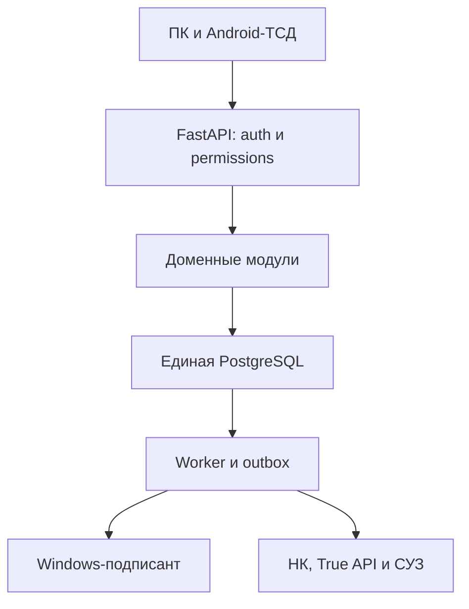

# Архитектура модульного монолита

Дата: 25.10.2026. Проектное решение, если явно не указано иное.

Один FastAPI backend, одна PostgreSQL, один frontend и отдельный процесс worker из того же кода.
Модули core/auth, permissions, rules, organizations, products, codes, documents, operations, audit;
modules/nk, marking, logistics, warehouse, split, labels, incidents. Интеграции обращаются наружу только из общего механизма операций.
Не использовать iframe, четыре старых приложения, четыре SQLite или отдельный backend ТСД.

Application services управляют транзакцией, проверяют permission/scope, версии и инварианты.
Доменные модели не вызывают HTTP. Адаптеры не меняют документы напрямую; возвращают нормализованный результат с provenance.
API возвращает 401 без сессии, 403 при недостаточных правах и 409 при конфликте версий/этапа.
UI получает capability+причину блокировки, но сервер повторяет проверки при выполнении команды.

Первый deploy — чистая БД. Старые данные и документы не мигрируют.
Текущий репозиторий содержит проектирование и инфраструктурный каркас, а не готовую ERP. Все описанные ограничения должны быть реализованы и проверены.
